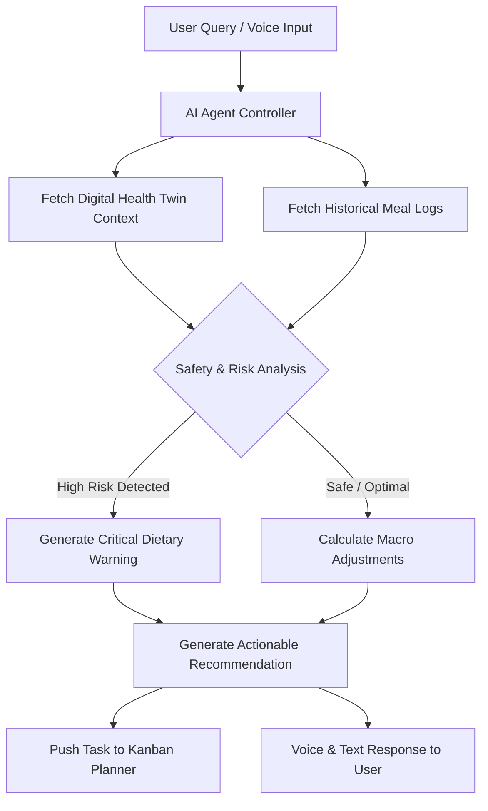

# NutriVision AI 🥗 AI-Powered Health & Personalized Nutrition Platform

[](https://idealize2026.lk)
[](https://reactnative.dev/)
[](https://expo.dev/)
[](https://fastapi.tiangolo.com/)
[](https://python.org)

**NutriVision AI** is an advanced health and personalized nutrition platform designed for **IDEALIZE 2026 (Open Category)**. Unlike simple calorie counters or static chatbots, NutriVision introduces a **functioning autonomous AI Agent**, a **Digital Health Twin**, computer vision food classification microservice, real-time disease risk assessment, and an interactive Kanban health planner.

---

## 📌 Table of Contents

- [Overview & Problem Statement](#-overview--problem-statement)
- [Core Features](#-core-features)
- [Architecture & Tech Stack](#-architecture--tech-stack)
- [AI Agent Reasoning & Workflow](#-ai-agent-reasoning--workflow)
- [Microservices & Repositories](#-microservices--repositories)
- [Setup & Local Installation](#-setup--local-installation)
- [Future Enhancements](#-future-enhancements)

---

## 🎯 Overview & Problem Statement

Traditional nutrition applications focus solely on macro and calorie logging. However, they lack context regarding individual biometrics, medical history, active health risks (such as Diabetes or Migraines), and contextual decision-making.

**NutriVision AI** solves this by providing:
1. **Computer Vision Food Classification**: Instant scanning and nutrient breakdown of meal images.
2. **Digital Health Twin**: Dynamic modeling of biometrics, active medical conditions, and risk thresholds.
3. **Autonomous AI Agent Coach**: A multi-step reasoning agent that analyzes health metrics, checks dietary safety, and recommends targeted interventions.
4. **Kanban Health Planner**: Drag-and-drop planning tool to organize daily nutrition goals, meal prep, and wellness tasks.

---

## 🚀 Core Features

### 1. 🤖 Autonomous AI Agent Coach & Voice Assistant
- Real-time medical-grade health coaching via text and voice commands.
- Multi-step reasoning pipeline evaluating user biometrics, disease risk indicators, and recent food logs.
- Generates safety warnings for harmful ingredients relative to user conditions.

### 2. 📸 Computer Vision Food Scanning
- Captures or uploads meal photos.
- Automatic image compression (up to 5MB threshold) and multi-part upload.
- Microservice classification returning confidence scores, calories, macros (Protein, Fat, Carbs, Fiber), and ingredient categories.

### 3. 🧬 Digital Health Twin & Disease Risk Assessment
- Real-time calculation of risk factors for Diabetes Type 2, Hypertension, Heart Disease, and Migraines.
- Condition checker allowing users to track symptoms, medications, and dietary triggers.

### 4. 📋 Kanban Health & Meal Planner
- Visual board (To-Do, In Progress, Done) for tracking nutrition habits, hydration, and medication tasks.
- Seamless one-tap task generation directly from AI Agent recommendations.

---

## 🛠️ Architecture & Tech Stack

### **Frontend App**
- **Framework**: [React Native](https://reactnative.dev/) (v0.86) with [Expo](https://expo.dev/) (v57.0)
- **Language**: TypeScript
- **State & UI**: React Context API, Lucide Icons, Expo Vector Icons, React Native Safe Area Context
- **Navigation**: `@react-navigation/native-stack`, `@react-navigation/bottom-tabs` (v7)

### **Backend & Microservices**
- **Classification Backend Microservice**: FastAPI service handling food detection, nutrition analysis, and database management.
- **Repository**: `git@github.com:Kushan20070126/foods_cla-svc.git`
- **Environment & Dependency Manager**: `uv` (Fast Rust-based Python package manager)
- **Python Version**: Python >= 3.12

---

## 🧠 AI Agent Reasoning & Workflow

The NutriVision AI Agent operates on a multi-step agentic workflow rather than single-prompt completions:



### Agent Steps:
1. **Input Ingestion**: Parses natural language query or spoken audio.
2. **Context Retrieval**: Queries local state for active medical conditions (e.g., Hypertension) and daily calorie intake.
3. **Safety Verification**: Evaluates ingredients against known triggers in the health profile.
4. **Action & Planning**: Suggests meal alternatives and automatically creates actionable cards in the **Kanban Planner**.

---

## 🔗 Microservices & Repositories

| Component | Repository / Path | Description |
|---|---|---|
| **Mobile App (Frontend)** | Main Repository | React Native / Expo application user interface |
| **Classification Backend Microservice** | [`git@github.com:Kushan20070126/foods_cla-svc.git`](https://github.com/Kushan20070126/foods_cla-svc.git) | FastAPI microservice for image food classification & nutrition data |

---

## ⚙️ Setup & Local Installation

### Prerequisites
- Node.js (v18+)
- Python (v3.12+)
- [`uv`](https://docs.astral.sh/uv/) Python package manager

---

### 1. Frontend Mobile App Setup

```bash
# Clone the main repository
git clone <main-repo-url>
cd "nutrivision app"

# Install dependencies
npm install

# Start Expo development server
npx expo start
```

---

### 2. Classification Backend Microservice Setup

```bash
# Navigate to microservice directory or clone standalone repo
cd foods_cla-svc
# Standalone Repo: git clone git@github.com:Kushan20070126/foods_cla-svc.git

# Install dependencies and sync virtual environment using uv
uv sync

# Run FastAPI backend development server
# Note: On Windows PowerShell, set UTF-8 encoding environment variable
$env:PYTHONIOENCODING="utf-8"
uv run fastapi dev main.py
```

The backend server will start on `http://127.0.0.1:8000`. You can access interactive API docs at `http://127.0.0.1:8000/docs`.

---

## 🔮 Future Enhancements

- **Wearable Device Integration**: Real-time sync with Apple HealthKit & Google Fit biometrics.
- **Continuous Glucose Monitor (CGM) Integration**: Real-time blood sugar spike prediction post-meals.
- **Edge Computer Vision Model**: On-device TensorFlow Lite / CoreML inference for offline food detection.

---

### 📄 License & Submissions
Organized for **IDEALIZE 2026** by AIESEC in University of Moratuwa.
